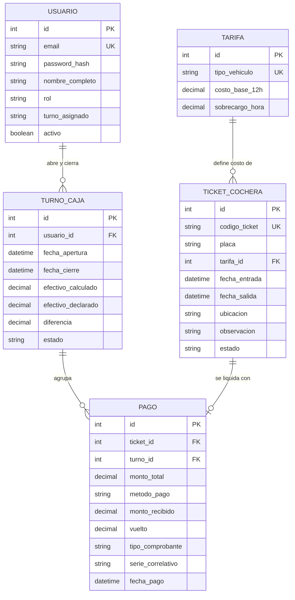

# Sistema de Gestión – Cochera Los Ángeles

Sistema de escritorio diseñado para automatizar y optimizar el control de ingresos y salidas vehiculares, el cálculo de tarifas, la gestión de cobros y el arqueo de caja por turnos de la **Cochera Los Ángeles**, ubicada en la Av. José Gabriel Condorcanqui 1413, distrito de La Esperanza, Trujillo – Perú.

---

## 1. Introducción

La gestión diaria de un estacionamiento implica registrar continuamente entradas y salidas de vehículos, calcular montos según el tiempo de permanencia y la categoría vehicular, emitir comprobantes y cuadrar el dinero recaudado al final de cada turno. 

Tradicionalmente, la Cochera Los Ángeles realizaba estos procesos de forma manual en papel, lo que generaba cinco problemas operativos principales:
* **Control vehicular:** Dificultad para rastrear estancias prolongadas y consultar rápidamente por placa o número de ticket.
* **Tarificación:** Errores de cálculo manual al aplicar tarifas base de 12 horas y sobrecargos por horas extra según el tipo de vehículo.
* **Cobros:** Falta de vinculación ordenada entre cada ticket y su medio de pago (Efectivo, Yape o Plin).
* **Turnos y arqueo:** Descuadres frecuentes al contrastar el efectivo físico con lo recaudado durante el turno y en el corte diario.
* **Supervisión y datos:** Ausencia de historial estructurado, control de accesos por rol y reportes consolidados.

Este proyecto surge para reemplazar el control manual por una plataforma digital ordenada, trazable y fácil de usar para personal con cualquier nivel de experiencia tecnológica.

---

## 2. Descripción General del Proyecto

### 2.1. Objetivo General
Automatizar el registro de vehículos, el cálculo de tarifas, el cobro de salidas y el control de caja por turnos de la Cochera Los Ángeles, mejorando la precisión operativa, la transparencia hacia los conductores y la supervisión administrativa.

### 2.2. Alcance y Funcionalidades por Perfil

El sistema separa las operaciones en dos perfiles de usuario con permisos diferenciados:

#### Perfil Empleado (Cajero)
* **Gestión de Turno de Caja:** Apertura obligatoria de turno antes de operar (máximo un turno abierto a la vez por empleado), cierre de turno con declaración de efectivo físico y cálculo automático de diferencias (arqueo).
* **Registro de Entrada (Check-in):** Registro de placa, tipo de vehículo (obligatorio), ubicación y observaciones. Genera automáticamente un código único con formato `TK-AAAA-NNNNNN` y un ticket térmico simulado de 58 mm.
* **Monitoreo en Vivo (Autos dentro):** Visualización en tiempo real de los vehículos estacionados (actualización automática cada 5 segundos) con alertas visuales según el tiempo transcurrido:
  * **OK:** Menos de 10 horas.
  * **POR VENCER:** Entre 10 horas y menos de 12 horas.
  * **+12H:** 12 horas o más.
* **Salida y Cobro (Check-out):** Búsqueda por placa o código de ticket, desglose automático del tiempo y monto a pagar, selección de método de pago (`Efectivo`, `Yape`, `Plin`), cálculo de vuelto en efectivo y emisión de comprobante simulado (Ticket, Boleta `B001` o Factura `F001`). Impide cobrar un ticket que ya fue pagado o anulado.

#### Perfil Administrador
* **Supervisión y Reportes:** Resumen diario de ingresos, vehículos dentro, distribución por método de pago, revisión de turnos cerrados y generación del **Cierre General de 2 PM**.
* **Gestión de Pagos:** Consulta histórica por rango de fechas, corrección del método de pago y anulación de registros (conservando siempre la trazabilidad histórica).
* **Mantenimiento de Tarifario:** Visualización y actualización de costos base y sobrecargos por categoría vehicular (con validación contra valores negativos).
* **Gestión de Usuarios:** Registro y administración de empleados del sistema.
* **Exportación de Datos:** Generación de reportes de ventas en formato `.csv` (14 columnas, compatible con Excel) y simulación de tickets térmicos en archivo `.txt`.

### 2.3. Regla de Negocio para Tarificación
El cálculo de cobro se basa en bloques de 12 horas según la categoría del vehículo:
1. **Estancia base:** Si el vehículo permanece menos de 12 horas, paga la tarifa base correspondiente a su categoría.
2. **Tolerancia:** Pasadas las 12 horas, cuenta con **30 minutos de tolerancia gratuita**.
3. **Horas extra:** A partir del minuto 31 adicional, cada fracción de hora se cobra como una hora extra completa según el sobrecargo de su categoría.
4. **Tope de sobrecargo:** El acumulado de horas extra nunca supera el costo de un nuevo bloque base de 12 horas.

### 2.4. Enfoque de Responsabilidad Social y Ética
* **Ecoeficiencia:** Digitalización de registros para reducir el uso de cuadernos e impresión opcional de tickets físicos.
* **Transparencia:** El conductor conoce su hora de ingreso, tiempo exacto y desglose tarifario antes de efectuar el pago.
* **Privacidad y Marco Legal:** Protección de contraseñas mediante hash `SHA-256` y almacenamiento mínimo de datos personales en concordancia con la Ley de Protección de Datos Personales (Ley N.° 29733). Los comprobantes cuentan con series y correlativos simulados para control interno (sin conexión directa a SUNAT).

---

## 3. Base de Datos y Modelo de Datos

### 3.1. Estrategia de Almacenamiento y Persistencia
El sistema está estructurado sobre un **esquema relacional** que garantiza la integridad entre usuarios, turnos, tarifas, tickets y pagos:
* **Entorno operativo actual:** Utiliza una capa de almacenamiento en memoria que replica la estructura y relaciones de las tablas del modelo relacional, precargada con un conjunto de datos iniciales para pruebas y demostraciones.
* **Persistencia en archivos externos:** Genera archivos planos en disco para la operación diaria:
  * **Reportes (`.csv`):** Exportación estructurada de 14 columnas para análisis financiero y apertura directa en hojas de cálculo (Excel).
  * **Comprobantes (`.txt`):** Emulación de tira de papel térmico de 58 mm para tickets de entrada y salida.

### 3.2. Diagrama Entidad-Relación (ER)

### 3.3. Diccionario de Entidades Principales

| Entidad / Tabla | Descripción | Campos Clave y Reglas |
| :--- | :--- | :--- |
| **`USUARIO`** | Almacena las cuentas de acceso del personal autorizado (Empleados y Administradores). | `id`, `email` (único), `password_hash` (cifrado en SHA-256), `nombre_completo`, `rol`, `turno_asignado` (`MAÑANA` / `NOCHE`), `activo`. |
| **`TURNO_CAJA`** | Registra cada sesión de caja abierta por un empleado para controlar la recaudación. | `id`, `usuario_id`, `fecha_apertura`, `fecha_cierre`, `efectivo_calculado`, `efectivo_declarado`, `diferencia`, `estado`. *Regla:* Un empleado solo puede tener un turno abierto a la vez. |
| **`TARIFA`** | Catálogo de categorías vehiculares y sus montos vigentes. | `id`, `tipo_vehiculo` (ej. Auto, Moto Lineal, Camioneta), `costo_base_12h`, `sobrecargo_hora`. *Regla:* No se permiten valores negativos. |
| **`TICKET_COCHERA`** | Registro de cada estadía vehicular desde el ingreso hasta la salida o anulación. | `id`, `codigo_ticket` (único, formato `TK-AAAA-NNNNNN`), `placa`, `tarifa_id`, `fecha_entrada`, `fecha_salida`, `ubicacion`, `observacion`, `estado`. *Regla:* Impide registrar una placa que ya se encuentra activa dentro de la cochera. |
| **`PAGO`** | Registro financiero que liquida un ticket y lo asocia al turno de caja del cajero que cobra. | `id`, `ticket_id`, `turno_id`, `monto_total`, `metodo_pago`, `monto_recibido`, `vuelto`, `tipo_comprobante`, `serie_correlativo` (`B001`/`F001`), `fecha_pago`. |

### 3.4. Catálogos y Dominios de Estados
Para mantener la integridad de los datos, el modelo restringe los valores permitidos en los siguientes campos:
* **Roles de Usuario:** `ADMINISTRADOR`, `EMPLEADO` (Cajero).
* **Estados de Turno:** `ABIERTO`, `CERRADO`.
* **Estados de Ticket:** `ACTIVO` (Dentro), `PAGADO`, `ANULADO`.
* **Métodos de Pago:** `EFECTIVO`, `YAPE`, `PLIN`.
* **Niveles de Alerta de Permanencia:** `OK` (< 10h), `POR VENCER` (10h – <12h), `+12H` ($\ge$ 12h).

### 3.5. Cardinalidad y Relaciones
1. **Usuario – Turno de Caja (`1:N`):** Un empleado puede abrir múltiples turnos a lo largo del tiempo, pero el sistema valida que solo exista uno en estado `ABIERTO` simultáneamente.
2. **Tarifa – Ticket (`1:N`):** Una categoría tarifaria se aplica a múltiples tickets registrados en la cochera.
3. **Ticket – Pago (`1:1`):** Un ticket se liquida mediante un único registro de pago; una vez marcado como `PAGADO` o `ANULADO`, se bloquea cualquier intento de cobro duplicado.
4. **Turno de Caja – Pago (`1:N`):** Cada pago queda vinculado al turno activo del cajero que realiza el cobro (incluso si otro empleado registró el ingreso), permitiendo calcular el arqueo y detectar diferencias de efectivo con exactitud.

---

## 4. Equipo de Desarrollo (Grupo 3)

Proyecto desarrollado por estudiantes de la carrera de Ingeniería de Sistemas Computacionales – Universidad Privada del Norte (UPN), Trujillo – Perú:

* **Araujo Lazo, Pamela Lisette**
* **Cabrera Castillo, Nilton Manolo**
* **Castro Aguilar, Axel David**
* **Castro Reyes, Leslie Melanie**
* **Obeso Guarniz, Marcos Diego**
* **Palacios Alzamora, Oskar Alonso**