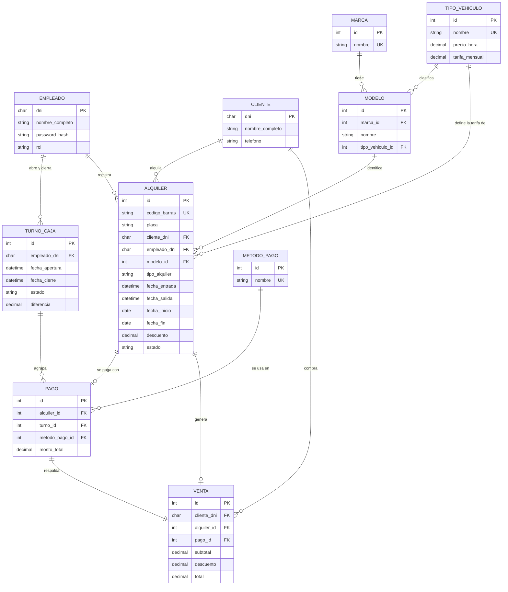

# Sistema de Gestión – Cochera Los Ángeles

Sistema de escritorio en **Java (Swing + NetBeans)** para controlar las entradas y salidas de vehículos, calcular el cobro, registrar clientes y ventas, manejar alquileres por mes y cuadrar la caja por turnos de la **Cochera Los Ángeles** (Av. José Gabriel Condorcanqui 1413, La Esperanza, Trujillo – Perú).

> **Versión actual: v2.0.** Incluye los requerimientos RP-01 (cliente y venta), RP-02 (marca y modelo) y RP-03 (alquiler mensual con 10% de descuento), el inicio de sesión con DNI, la clase `Alquiler` con `calcularMonto()` y el registro de tipos de vehículo nuevos.

**Documentación:** [Manual de usuario](docs/manual_usuario.md) · [Pruebas manuales](docs/pruebas_manuales.md) · [Documento técnico](docs/README.md) · [Scripts SQL](sql/)

---

## Introducción y alcance

La gestión diaria de un estacionamiento implica registrar continuamente entradas y salidas de vehículos, calcular montos según el tiempo de permanencia y la categoría vehicular, emitir comprobantes y cuadrar el dinero recaudado al final de cada turno. 

Tradicionalmente, la Cochera Los Ángeles realizaba estos procesos de forma manual en papel, lo que generaba cinco problemas operativos principales:
* **Control vehicular:** Dificultad para rastrear estancias prolongadas y consultar rápidamente por placa o número de ticket.
* **Tarificación:** Errores de cálculo manual del monto según el tiempo de permanencia y el tipo de vehículo.
* **Cobros:** Falta de vinculación ordenada entre cada ticket y su medio de pago (Efectivo, Yape o Plin).
* **Turnos y arqueo:** Descuadres frecuentes al contrastar el efectivo físico con lo recaudado durante el turno y en el corte diario.
* **Supervisión y datos:** Ausencia de historial estructurado, control de accesos por rol y reportes consolidados.

Este proyecto surge para reemplazar el control manual por una plataforma digital ordenada, trazable y fácil de usar para personal con cualquier nivel de experiencia tecnológica.

### Objetivo general
Automatizar el registro de vehículos, el cálculo de tarifas, el cobro de salidas y el control de caja por turnos de la Cochera Los Ángeles, mejorando la precisión operativa, la transparencia hacia los conductores y la supervisión administrativa.

### Alcance por perfil

El sistema separa las operaciones en dos perfiles de usuario con permisos diferenciados:

#### Perfil Empleado (Cajero)
* **Gestión de Turno de Caja:** Apertura obligatoria de turno antes de operar (máximo un turno abierto a la vez por empleado), cierre de turno con declaración de efectivo físico y cálculo automático de diferencias (arqueo).
* **Registro de Entrada (Check-in):** DNI del cliente (se registra si es nuevo), placa, marca y modelo en combos ("Desconocido" por defecto), tipo de vehículo (obligatorio) y modalidad por hora o por mes. Genera automáticamente un código único con formato `TK-AAAA-NNNNNN` y un ticket térmico simulado de 58 mm.
* **Monitoreo en Vivo (Autos dentro):** Visualización en tiempo real de los vehículos estacionados (actualización automática cada 5 segundos) con alertas visuales según el tiempo transcurrido:
  * **OK:** Menos de 10 horas.
  * **POR VENCER:** Entre 10 horas y menos de 12 horas.
  * **+12H:** 12 horas o más.
  * En los alquileres por mes: **MENSUAL**, **POR VENCER (MES)** en los últimos 3 días y **+MES VENCIDO**.
* **Salida y Cobro (Check-out):** Búsqueda por placa, código de ticket o DNI del cliente, desglose automático del tiempo y monto a pagar, selección de método de pago (`Efectivo`, `Yape`, `Plin`), cálculo de vuelto en efectivo y emisión del ticket de salida (comprobante interno simulado, con subtotal, descuento y total). Impide cobrar un ticket que ya fue pagado o anulado.

#### Perfil Administrador
* **Supervisión y Reportes:** Resumen diario de ingresos, vehículos dentro, distribución por método de pago, revisión de turnos cerrados y generación del **Cierre General de 2 PM**.
* **Gestión de Pagos:** Consulta histórica por rango de fechas, corrección del método de pago y anulación de registros (conservando siempre la trazabilidad histórica).
* **Mantenimiento de Tarifario:** Visualización y actualización de la tarifa por hora y la tarifa mensual de cada tipo de vehículo, y registro de tipos nuevos (con validación contra valores negativos).
* **Gestión de Usuarios:** Registro de empleados con DNI y contraseña.
* **Clientes, marcas y modelos:** CRUD de clientes con sus ventas, y mantenimiento de marcas, modelos y tipos de vehículo.
* **Alquiler mensual:** Consulta de alquileres por mes por cliente con el 10% de descuento por vehículo.
* **Exportación de Datos:** Generación de reportes de ventas en formato `.csv` (una fila por cobro y fila de total, compatible con Excel) y simulación de tickets térmicos en archivo `.txt`.

### Responsabilidad social y ética
* **Ecoeficiencia:** Digitalización de registros para reducir el uso de cuadernos e impresión opcional de tickets físicos.
* **Transparencia:** El conductor conoce su hora de ingreso, tiempo exacto y desglose tarifario antes de efectuar el pago.
* **Privacidad y Marco Legal:** Protección de contraseñas mediante hash `SHA-256` y almacenamiento mínimo de datos personales en concordancia con la Ley de Protección de Datos Personales (Ley N.° 29733). Los comprobantes cuentan con series y correlativos simulados para control interno (sin conexión directa a SUNAT).

---

## 1. Requisitos

| Programa | Versión | Para qué |
| :--- | :--- | :--- |
| **JDK** (Java Development Kit) | 8 o superior (recomendado 17 o 21) | Compilar y ejecutar. NetBeans 17+ ya trae un JDK. |
| **Apache NetBeans** | 12 o superior | Abrir el proyecto, editar los formularios y ejecutar. |
| **SQL Server** + **SSMS** *(opcional)* | 2019 o superior (Express sirve) | Crear la base de datos con los scripts de `sql/`. |
| **Driver JDBC de SQL Server** *(opcional)* | `mssql-jdbc` 12.x | Conectar Java con SQL Server. |

Comprueba el JDK con:

```
java -version
javac -version
```

## 2. Cómo ejecutar

### 2.1 Desde NetBeans (recomendado)

1. `File > Open Project…` y elige la carpeta del repositorio (NetBeans la reconoce como proyecto por la carpeta `nbproject`).
2. Clic derecho en el proyecto → `Clean and Build`.
3. `Run` (F6). La clase principal es `cochera.Ejec_Cochera` (versión con ventanas).
4. Inicia sesión con uno de los [usuarios de prueba](#4-usuarios-y-datos-de-prueba).

Los formularios (`*.form`) se editan en la vista **Design** de NetBeans; el código dentro de `initComponents()` lo genera NetBeans y no se modifica a mano.

### 2.2 Sin NetBeans (Windows)

Doble clic en `ejecutar.bat`: compila todo en la carpeta `bin` y abre la versión con ventanas. También se puede hacer a mano:

```
javac -encoding UTF-8 -d bin src\cochera\*.java src\cochera\datos\*.java src\cochera\dto\*.java src\cochera\excepcion\*.java src\cochera\gui\*.java src\cochera\impresion\*.java src\cochera\modelo\*.java src\cochera\prueba\*.java src\cochera\servicio\*.java src\cochera\util\*.java src\cochera\vista\*.java
java -cp bin cochera.Ejec_Cochera
```

Versión por consola (mismas reglas de negocio): `java -cp bin cochera.Ejec_CocheraConsola`

### 2.3 Pruebas automáticas

Después de compilar, cada prueba imprime `[PASA]` o `[FALLA]` y un resumen:

```
java -cp bin cochera.prueba.PruebaCalculoTarifa      (cobro por minuto, ejemplos de HU-09)
java -cp bin cochera.prueba.PruebaFlujoOperativo     (login con DNI, turnos, entrada, salida, ventas, admin)
java -cp bin cochera.prueba.PruebaMarcaModelo        (combos de marca/modelo, tipos de vehículo)
java -cp bin cochera.prueba.PruebaAlquilerMensual    (10% de descuento por vehículo)
```

Resultado en la versión v2.0: **110 pruebas pasan, 0 fallan**. Los casos de prueba manuales están en [docs/pruebas_manuales.md](docs/pruebas_manuales.md).

## 3. Base de datos

### 3.1 Cómo funciona en esta versión

La aplicación guarda los datos **en memoria** (`src/cochera/datos/BaseDatos.java`): cada lista es una tabla y antes de insertar o eliminar se validan las llaves primarias y foráneas igual que en la base real (por ejemplo, no se elimina un cliente con ventas). Al abrir el programa se cargan los datos de prueba de `DatosIniciales.java`. **Al cerrar el programa los datos se pierden.**

El modelo relacional completo para SQL Server está en dos scripts:

| Archivo | Contenido |
| :--- | :--- |
| [`sql/schema.sql`](sql/schema.sql) | Crea la base `CocheraLosAngeles`, sus 10 tablas con llaves primarias, foráneas y restricciones, la vista `v_ventas_cliente` (JOIN cliente–venta) y el procedimiento `sp_consultar_transacciones(dni, fecha1, fecha2)`. |
| [`sql/datos.sql`](sql/datos.sql) | Inserta los mismos datos de prueba que usa la aplicación (usuarios, tarifario, marcas, modelos, clientes, alquileres y ventas) y deja consultas de ejemplo al final. |

### 3.2 Cómo crear la base

**Con SQL Server Management Studio (SSMS):**

1. Conéctate a tu servidor (por ejemplo `localhost` o `localhost\SQLEXPRESS`).
2. `File > Open > File…` → abre `sql/schema.sql` → `Execute` (F5). Se crea la base `CocheraLosAngeles`.
3. Abre `sql/datos.sql` → `Execute`.
4. Comprueba: `SELECT * FROM CocheraLosAngeles.dbo.v_ventas_cliente;`

**Por consola (sqlcmd):**

```
sqlcmd -S localhost -E -i sql\schema.sql
sqlcmd -S localhost -E -I -i sql\datos.sql
```

(`-E` usa la cuenta de Windows; con usuario de SQL Server usa `-U sa -P tu_clave`. Si usas SQL Express, el servidor es `localhost\SQLEXPRESS`.) Los scripts se pueden volver a ejecutar: `schema.sql` borra y vuelve a crear las tablas.

### 3.3 Driver JDBC (para conectar Java con SQL Server)

1. Descarga el **Microsoft JDBC Driver for SQL Server** desde la página oficial de Microsoft (archivo `mssql-jdbc-12.x.x.jre11.jar`; usa el `jre8` si trabajas con Java 8).
2. En NetBeans: clic derecho en el proyecto → `Properties` → `Libraries` → `Classpath` → `Add JAR/Folder…` → elige el `.jar`.
3. En *SQL Server Configuration Manager* habilita **TCP/IP** (puerto 1433) y reinicia el servicio; si vas a usar usuario y contraseña, activa la autenticación mixta.
4. Cadena de conexión de ejemplo:

```
jdbc:sqlserver://localhost:1433;databaseName=CocheraLosAngeles;encrypt=true;trustServerCertificate=true;user=sa;password=TU_CLAVE
```

> La conexión JDBC de la aplicación a SQL Server todavía no está en este repositorio: la versión v2.0 trabaja con la base en memoria descrita arriba. Cuando se suba, usará estos scripts, este driver y esta cadena de conexión.

### 3.4 Diagrama entidad–relación



## 4. Usuarios y datos de prueba

| Perfil | DNI | Contraseña | Nombre |
| :--- | :--- | :--- | :--- |
| Administrador | `11111111` | `admin123` | Administrador General |
| Cajero (vendedor) | `22222222` | `cajero123` | Carlos Ramírez |
| Cajero (vendedor) | `33333333` | `cajero123` | Maria Torres |

Clientes de demostración: `45678912` Juan Pérez Rojas, `47851236` Rosa Díaz Vega, `41236987` Luis Gómez Paredes, `48521473` Ana Castillo León y `46587912` Pedro Salazar Ruiz (tiene 2 autos por mes). Al iniciar hay 4 vehículos por hora dentro (con alertas OK, POR VENCER y +12H), 2 alquileres mensuales y un turno cerrado de ayer con 4 ventas. Desde **Herramientas de demostración** se puede adelantar el reloj para ver los cobros sin esperar.

## 5. Reglas de negocio

* **Cobro por hora** – `Alquiler.calcularMonto()`: minutos de permanencia × tarifa por hora / 60, redondeado a céntimos. Ej.: Auto a S/ 3.00 por hora con 60 min paga S/ 3.00; Camioneta a S/ 5.00 por hora con 90 min paga S/ 7.50.
* **Alquiler por mes** – `AlquilerMensual` **hereda** de `Alquiler` y **redefine** `calcularMonto()`: tarifa mensual del tipo × 0.90. El 10% se aplica **por vehículo**: un cliente con 2 autos de S/ 200.00 paga S/ 360.00. Guarda fecha de inicio y de fin (30 días); si se pasa del mes se cobra otro mes. El cobro por hora no cambia.
* **Cliente y venta** – Cada entrada pide el DNI del cliente (8 dígitos) y lo registra si es nuevo. Cada cobro genera una **venta** con el DNI del cliente como llave foránea; no hay venta sin cliente y no se elimina un cliente con ventas.
* **Marca y modelo** – Combo de marca y combo de modelo filtrado por la marca; por defecto "Desconocido". Cada modelo tiene su tipo de vehículo, del que sale la tarifa.
* **Turnos y caja** – Sin turno abierto no se registra ni se cobra. El pago queda en el turno de quien cobra. Al cerrar: diferencia = efectivo declarado − efectivo del sistema (Yape y Plin no entran).
* **Alertas** – Por hora: OK (< 10 h), POR VENCER (10 h a < 12 h), +12H. Por mes: MENSUAL, POR VENCER (MES) en los últimos 3 días y +MES VENCIDO.
* **Seguridad** – Contraseñas con hash SHA-256; solo el administrador crea cuentas y ve Mantenimiento (tarifario, usuarios, clientes, marcas y modelos).

## 6. Estructura del proyecto

```
src/cochera/
├── modelo/      Usuario, Empleado, Administrador, Cliente, Venta, Alquiler, AlquilerMensual,
│                TipoAlquiler, Marca, Modelo, Tarifa, TurnoCaja, Pago
├── datos/       BaseDatos (en memoria, con llaves primarias y foráneas) y DatosIniciales
├── servicio/    Autenticacion, Checkin, Checkout, Cliente, Venta, Vehiculo, AlquilerMensual,
│                Turno, Cobros, Monitoreo, Admin y ExportadorCSV
├── dto/         Resultados y reportes (ResultadoTarifa, CierreGeneral, KpiHoy...)
├── impresion/   Tickets de 58 mm (TicketEntrada, TicketSalida) e impresoras simuladas
├── gui/         Formularios NetBeans (FrmLogin, FrmPrincipal y una pestaña JPanel por tarea)
├── vista/       Menús de la versión por consola
├── util/        Dinero, FechaUtil, Placa, Dni, Reloj, Texto
└── prueba/      Pruebas automáticas
sql/             schema.sql y datos.sql (SQL Server)
docs/            Manual de usuario, pruebas manuales, documento técnico, capturas y diagramas
```

## 7. Flujo de trabajo en Git

* `main`: versiones estables, marcadas con las etiquetas **v1.0** (sistema base con cobro por bloques de 12 h) y **v2.0** (esta versión).
* `develop`: rama de integración; todo entra por Pull Request.
* `feature/*`: una rama por requerimiento. En la v2.0: `feature/cliente-venta` (PR #7, RP-01), `feature/marca-modelo` (PR #8, RP-02) y `feature/alquiler-mensual` (PR #9, RP-03).
* Commits con *Conventional Commits*: `feat(modelo): …`, `feat(gui): …`, `test: …`, `docs: …`.

## 8. Equipo de desarrollo (Grupo 3)

Estudiantes de Ingeniería de Sistemas Computacionales – Universidad Privada del Norte (UPN), Trujillo – Perú. Curso: Técnicas de Programación Orientada a Objetos.

* **Araujo Lazo, Pamela Lisette**
* **Cabrera Castillo, Nilton Manolo**
* **Castro Aguilar, Axel David**
* **Castro Reyes, Leslie Melanie**
* **Obeso Guarniz, Marcos Diego**
* **Palacios Alzamora, Oskar Alonso**
